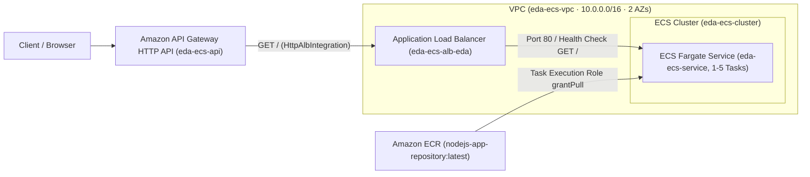

# Containerized Node.js Application on AWS (CDK, ECR, ECS Fargate, Docker & API Gateway)

This project implements a complete, production-structured containerized TypeScript/Node.js Express service deployed to **Amazon ECS on AWS Fargate** using **AWS CDK (TypeScript)**, **Docker**, **Amazon ECR**, **Application Load Balancer (ALB)**, and **Amazon API Gateway (HTTP API)**, along with **GitHub Actions CI/CD** workflows.

---

## Architecture Overview



### How the Pieces Fit Together
1. **`RepositoryStack` (`repoStack`)** provisions the Amazon ECR repository (`nodejs-app-repository`) first so you can build and push your Docker image before deploying the compute infrastructure.
2. **`ContainerizedAppStack`** receives the `ecr.Repository` object from `repoStack` and provisions the VPC, ECS Cluster, public Application Load Balanced Fargate Service (running your `latest` ECR image), auto-scaling policies, health checks, and an HTTP API Gateway route fronting the ALB.
3. **`container/`** is a standalone TypeScript Express application with its own `package.json`, `tsconfig.json`, `Dockerfile`, and compiled `build/` output.

---

## Project Structure

```text
containerized-app/
├── .github/
│   └── workflows/
│       ├── code.yml                      # CI/CD: build & push Docker image to ECR (on push to `dev`)
│       └── infrastructure-workflow.yml   # CI/CD: deploy CDK infrastructure (on push to `infra`)
├── bin/
│   └── containerized-app.ts              # CDK app entrypoint wiring repoStack -> ContainerizedAppStack
├── container/
│   ├── build/
│   │   └── index.js                      # Transpiled JavaScript output (`tsc --project tsconfig.json`)
│   ├── src/
│   │   └── index.ts                      # Express app listening on port 80 (`GET /`)
│   ├── .dockerignore                     # Excludes node_modules/.git while keeping build/
│   ├── Dockerfile                        # Multi-step Node 20 Alpine image running `build/index.js`
│   ├── package.json                      # Express app dependencies & npm/docker scripts
│   ├── package-lock.json                 # Locked dependencies for `npm ci` inside Docker
│   └── tsconfig.json                     # Compiles `src/*.ts` -> `build/` (CommonJS / ES6)
├── lib/
│   ├── repository-stack.ts               # ECR Repository stack (`RepositoryStack`)
│   └── containerized-app-stack.ts        # VPC, ECS Fargate, Auto Scaling, Health Check & API Gateway stack
├── test/
│   └── containerized-app.test.ts         # Jest test placeholder
├── cdk.json                              # AWS CDK toolkit configuration (`npx tsx bin/containerized-app.ts`)
├── jest.config.js                        # Jest + SWC configuration
├── package.json                          # Root CDK project manifest & scripts
└── tsconfig.json                         # Root TypeScript type-checking config (excludes `container/`)
```

---

## Component Breakdown

### 1. Containerized Node.js App (`container/`)
- **`container/src/index.ts`**: Starts an Express server on port `80` and responds to `GET /` with `Hi! ECS + ECR + FARGATE!`.
- **`container/tsconfig.json`**: Targets `ES6` with `CommonJS` modules and outputs compiled `.js` files into `container/build/`.
- **`container/package.json`**: Defines Express (`^4.19.2`), TypeScript (`^5.5.3`), and convenience scripts (`node:build`, `node:start`, `docker:build`, `docker:run`).
- **`container/Dockerfile`**:
  - Uses `node:20.15.1-alpine` with `NODE_ENV=production`.
  - Copies `package*.json` and installs production-only dependencies (`--omit=dev`).
  - Switches to the non-root `node` user (`USER node`).
  - Copies `./build` into the image, exposes port `80`, and runs `CMD ["node", "build/index.js"]`.
- **`container/.dockerignore`**: Excludes `node_modules`, `npm-debug.log`, `.git`, and `.gitignore` so `build/` is preserved for `COPY ./build ./build`.

### 2. ECR Repository Stack (`lib/repository-stack.ts`)
Defines `RepositoryStack`, which creates:
- **ECR Repository**: `nodejs-app-repository` with `removalPolicy: cdk.RemovalPolicy.DESTROY` (so `cdk destroy` can cleanly remove the stack in development).
- **CloudFormation Output**: Exports `RepositoryUri` (`${this.stackName}-RepositoryUri`) so you can copy the URI for `docker tag` and `docker push`.

### 3. Application Infrastructure Stack (`lib/containerized-app-stack.ts`)
Uses `PREFIX = "eda-ecs"` and accepts `ecrRepository: ecr.Repository` in its constructor to create:
- **VPC (`node-app-vpc` / `eda-ecs-vpc`)**: `10.0.0.0/16` CIDR spanning 2 Availability Zones (`maxAzs: 2`, `restrictDefaultSecurityGroup: false`).
- **ECS Cluster (`eda-ecs-cluster`)**: Serverless Fargate compute cluster inside the VPC.
- **Application Load Balanced Fargate Service (`eda-ecs-service` / `eda-ecs-alb-eda`)**:
  - `256` CPU units (`0.25 vCPU`), `512 MiB` memory, `desiredCount: 2`, `publicLoadBalancer: true`.
  - Pulls tag `latest` from `ecrRepository`, exposes container port `80`, and passes sample environment variables (`ENV_VAR_1`, `ENV_VAR_2`).
  - Grants the Fargate task execution role pull permissions via `ecrRepository.grantPull(service.taskDefinition.obtainExecutionRole())`.
- **Auto Scaling**: Scales task count between `1` and `5` instances, targeting `70%` CPU utilization (`CpuScaling`) and `70%` memory utilization (`RamScaling`).
- **Health Check**: Configures the ALB target group to check `GET /` and expect HTTP `200`.
- **API Gateway (`eda-ecs-api`)**: Creates an `apigw2.HttpApi` with a `GET /` route wired to `service.listener` via `HttpAlbIntegration`.

### 4. CDK App Entrypoint (`bin/containerized-app.ts`) & Root Config
- **`bin/containerized-app.ts`**: Instantiates `RepositoryStack` (`repoStack`) using `CDK_DEFAULT_ACCOUNT` and `CDK_DEFAULT_REGION`, then passes `repoStack.repository` into `ContainerizedAppStack`.
- **`tsconfig.json`**: Uses `"noEmit": true` for type-checking root CDK code and excludes `node_modules`, `cdk.out`, and `container` so the two TypeScript configs stay isolated.
- **`cdk.json`**: Configures `cdk` commands to execute `npx tsx bin/containerized-app.ts`.

---

## Prerequisites

- **Node.js** & **npm** installed
- **Docker Desktop** (or Docker Engine) installed and running
- **AWS CLI** installed and configured (`aws configure`) with credentials and default region
- **AWS CDK** (`npx cdk` is included in `devDependencies`, or install globally with `npm install -g aws-cdk`)

---

## Step-by-Step Deployment Guide

### Step 1: Build and Test the Container Locally
From the repository root (`containerized-app/`):

```bash
# 1. Install Express app dependencies (already installed if container/node_modules exists)
npm --prefix container install

# 2. Transpile TypeScript -> container/build/index.js
npm --prefix container run node:build
```

Then navigate into `container/` to build and test the Docker image locally (make sure Docker Desktop is running):

```bash
cd container

# Build the Docker image (tagged as "latest", or use `npm run docker:build` for `my-node-app`)
docker build -t latest .

# Run the container mapping local port 80 to container port 80
docker run -p 80:80 latest
```

Open `http://localhost:80/` in your browser — you should see:
`Hi! ECS + ECR + FARGATE!`

*(Shortcut scripts inside `container/`: `npm run docker:build` and `npm run docker:run`.)*

---

### Step 2: Bootstrap & Deploy the ECR Repository Stack
Return to the root `containerized-app/` directory:

```bash
cd ..

# Install root CDK dependencies (if not already installed)
npm install

# Type-check the CDK project
npm run build

# Bootstrap your AWS account/region for CDK (needed once per account/region)
npx cdk bootstrap

# Deploy only the ECR repository stack first
npx cdk deploy repoStack
```

Copy the **`RepositoryUri`** printed in the CloudFormation outputs (for example: `<account-id>.dkr.ecr.<region>.amazonaws.com/nodejs-app-repository`).

---

### Step 3: Authenticate Docker, Tag, and Push the Image to ECR
Replace `<region>` (e.g., `us-east-1`) and `<repo-uri>` with your `RepositoryUri`:

```bash
# 1. Authenticate Docker to your Amazon ECR registry
aws ecr get-login-password --region <region> | docker login --username AWS --password-stdin <repo-uri>

# 2. Tag your local image with the ECR repository URI (`latest` tag)
docker tag latest <repo-uri>:latest

# 3. Push the image to Amazon ECR
docker push <repo-uri>:latest
```

---

### Step 4: Synthesize and Deploy the Application Stack
Once the `latest` image exists in ECR, deploy `ContainerizedAppStack`:

```bash
# Optional: inspect the synthesized CloudFormation templates
npx cdk synth

# Deploy VPC, ECS Cluster, Fargate Service, ALB, Auto Scaling & HTTP API
npx cdk deploy ContainerizedAppStack
```

After deployment completes, CDK will output the ALB DNS / URL (and you can also find the `eda-ecs-api` endpoint in the AWS API Gateway console). Visiting `/` returns `Hi! ECS + ECR + FARGATE!`.

---

### Step 5: Clean Up AWS Resources
To avoid ongoing AWS charges (NAT Gateways, ALB, Fargate tasks) when finished:

```bash
npx cdk destroy ContainerizedAppStack
npx cdk destroy repoStack
```

*(Note: If `repoStack` fails to delete because images exist inside ECR, delete the images in the ECR console or enable `emptyOnDelete` before destroying.)*

---

## CI/CD with GitHub Actions (`.github/workflows/`)

Two workflow files are included for automating Docker image builds and infrastructure deployments:

1. **Required GitHub Repository Secrets** (`Settings -> Secrets and variables -> Actions -> New repository secret`):
   - `AWS_ACCESS_KEY_ID`
   - `AWS_SECRET_ACCESS_KEY`
   - `REPO_NAME` (your ECR repository name, e.g., `nodejs-app-repository`)

2. **`.github/workflows/code.yml`** (triggers on push to `dev`):
   - Checks out the repository, installs dependencies, compiles TypeScript, logs in to Amazon ECR, generates an image tag from `<short-commit-hash>-<timestamp>`, and builds/pushes the Docker image to ECR.
   - *Note*: The commands inside `code.yml` (`npm install`, `tsc --project tsconfig.json`, `docker build -t ... .`) are written assuming `container/` is the working directory; add `defaults: run: working-directory: container` (or pass `./container`) if running from the repository root.

3. **`.github/workflows/infrastructure-workflow.yml`** (triggers on push to `infra`):
   - Checks out the repository, sets up Node 20, installs `aws-cdk` and dependencies, deploys the CDK stack, and fetches the `eda-ecs-alb-eda` DNS name.
   - *Note*: The workflow currently runs `cdk deploy InfraStructureStack` per the course template; update the stack name to `ContainerizedAppStack` (matching `bin/containerized-app.ts`) before running it against your AWS account.

---

## Useful Commands

| Scope | Command | Purpose |
| :--- | :--- | :--- |
| Root CDK | `npm run build` | Type-check the CDK TypeScript files (`tsc` with `noEmit`) |
| Root CDK | `npm run watch` | Watch and re-check CDK TypeScript files on change |
| Root CDK | `npm test` | Run Jest unit tests in `test/` |
| Root CDK | `npx cdk list` | List defined CDK stacks (`repoStack`, `ContainerizedAppStack`) |
| Root CDK | `npx cdk synth` | Synthesize CloudFormation templates to `cdk.out/` |
| Root CDK | `npx cdk diff` | Compare local stacks against deployed AWS stacks |
| Root CDK | `npx cdk deploy <StackName>` | Deploy `repoStack` or `ContainerizedAppStack` |
| Container App | `npm --prefix container run node:build` | Compile `container/src/index.ts` to `container/build/index.js` |
| Container App | `npm --prefix container run node:start` | Run the compiled Express app locally with Node.js |
| Container App | `npm --prefix container run docker:build` | Build the Docker image (`my-node-app`) from `container/` |
| Container App | `npm --prefix container run docker:run` | Run the Docker container on port `80` |
